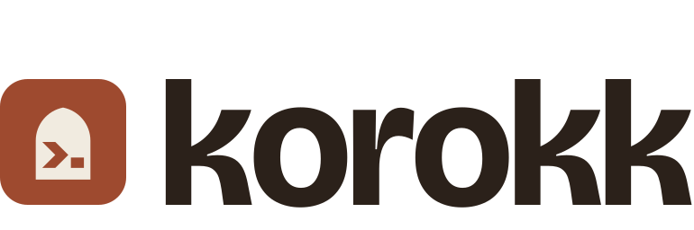
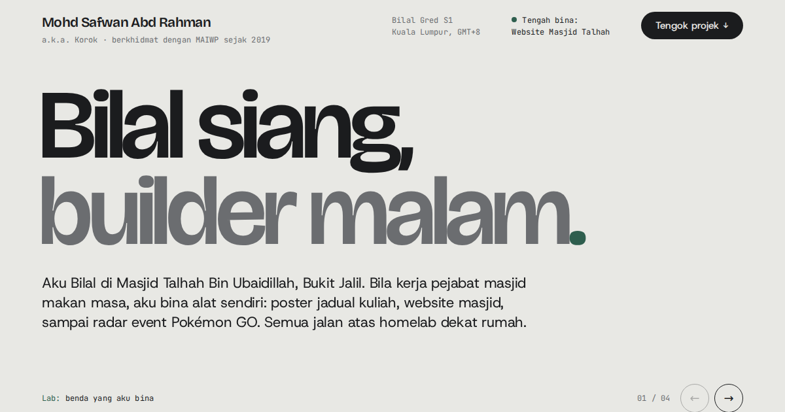
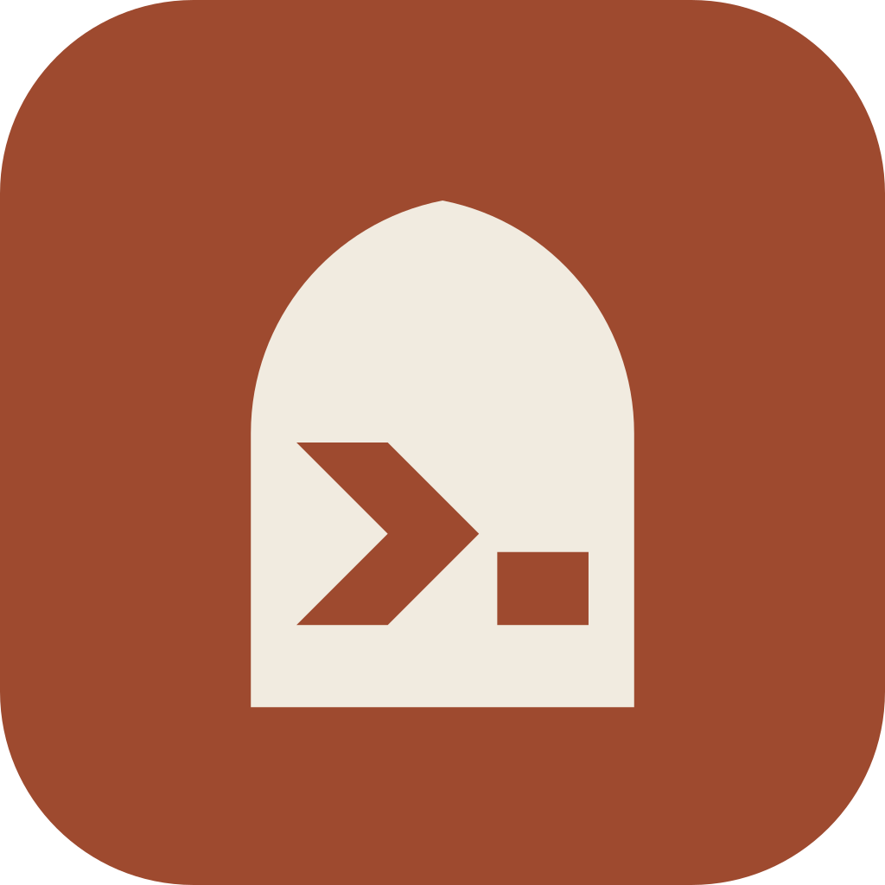

<p>
  <picture>
    <source media="(prefers-color-scheme: dark)" srcset="brand/svg/korokk-mendatar-gelap.svg">
    
  </picture>
</p>

# korokk.com

Laman portfolio peribadi Mohd Safwan Abd Rahman (Korok): Bilal siang, builder malam.

**Live:** https://korokk.com/ (repo `Kengkorok.github.io`)



## Isi kandungan

- **Lab**: slaid projek dengan video pratonton
  - Website Masjid Talhah (akan dilancarkan)
  - [Pallet Office](https://korokk.com/pallet-office/): session Claude Code sebagai Pokémon
  - [PoGo Wave Radar](https://korokk.com/pogo-wave-radar/)
  - [Jadual Kuliah Generator](https://github.com/Kengkorok/jadual-kuliah-generator)
  - [Servis Tracker](https://korokk.com/Auto-Services-Tracker/)
- **Kerjaya**: Masjid Talhah, Masjid Abdul Rahman Bin Auf, DevOps dan Homelab
- **[Blog](https://korokk.com/blog/)**: tulisan dengan tag, carian dan komen
- **Hubungi**: GitHub, Threads, TikTok dan Ko-fi
- **Mod gelap**: suis matahari/bulan di nav laman utama dan blog. Ikut tetapan peranti selagi pelawat belum pilih sendiri, dan pilihan diingat (`localStorage`)

## Teknologi

HTML, CSS dan JavaScript biasa, tiada framework. GitHub Pages jalankan Jekyll untuk bahagian blog sahaja; laman lain disalin terus.

| Fail | Fungsi |
| --- | --- |
| `index.html` | Kandungan laman |
| `styles.css` | Gaya dan susun atur (desktop, tablet, telefon) |
| `main.js` | Suis tema, slaid Lab, video lazy-load, kad bertindan, kursor Kerjaya dan animasi |
| `assets/lab/` | Video pratonton (`.mp4` + versi `-mobile`) dan poster |
| `assets/career/` | Gambar untuk kad kerjaya |
| `pallet-office/` | Demo replay statik [Pallet Office](https://github.com/Kengkorok/pallet-office) |
| `_posts/` | Tulisan blog (`.md` atau `.html`) |
| `_layouts/`, `_includes/` | Templat Jekyll untuk blog |
| `blog/`, `blog.css`, `blog.js` | Senarai tulisan, carian, tag dan komen |
| `brand/` | Logo, ikon dan [panduan jenama](https://korokk.com/brand/panduan.html) |
| `workers/komen/` | Cloudflare Worker untuk komen tanpa akaun ([panduan](workers/komen/README.md)) |

## Jalankan secara local

Laman utama dan blog perlu Jekyll. Cara paling mudah guna imej Docker yang sama dengan GitHub Pages:

```bash
docker run --rm -u "$(id -u):$(id -g)" -e HOME=/tmp -v "$PWD":/github/workspace/src -v "$PWD/_site":/github/workspace/out -e GITHUB_WORKSPACE=/github/workspace -e INPUT_SOURCE=src -e INPUT_DESTINATION=out -e GITHUB_REPOSITORY=Kengkorok/Kengkorok.github.io -e INPUT_TOKEN="$(gh auth token)" ghcr.io/actions/jekyll-build-pages:v1.0.13
python3 -m http.server 4000 -d _site
```

Kemudian buka http://localhost:4000.

## Tulis post blog

1. Salin [`_drafts/templat.md`](_drafts/templat.md) ke `_posts/2026-11-03-tajuk-pendek.md`. Nama fail jadi URL: `/blog/tajuk-pendek/`.
2. Isi `title`, `description` dan `tags`. Letak gambar dalam `assets/blog/2026/tajuk-pendek/`.
3. Commit dan push. GitHub Pages siarkan dalam ~1 minit.

Nota:
- Post bertarikh masa depan tak keluar sehingga ada push lain selepas tarikh tu.
- `image` jadi cover dan imej pratonton bila link dikongsi. Tanpa `image`, guna `assets/og.png`.
- Garis bawah guna `<u>teks</u>`. HTML biasa boleh dicampur dalam Markdown.

## Komen

Setiap post ada dua tab:
- **Nama sahaja**: melalui [`workers/komen`](workers/komen/README.md), disemak dulu sebelum dipapar. Tab ni tersorok selagi `komen.api` dalam `_config.yml` kosong.
- **Guna GitHub**: [giscus](https://giscus.app). Komen disimpan dalam Discussions repo ni (kategori Announcements). Perlu app [giscus](https://github.com/apps/giscus) dipasang pada repo.

## Tambah projek baru

1. Rakam video demo, kemudian tukar ke MP4:
   ```bash
   ffmpeg -i demo.webm -an -vf "scale=1280:-2" -c:v libx264 -crf 26 -pix_fmt yuv420p -movflags +faststart assets/lab/nama.mp4
   ffmpeg -i demo.webm -an -vf "scale=640:-2" -c:v libx264 -crf 28 -pix_fmt yuv420p -movflags +faststart assets/lab/nama-mobile.mp4
   ffmpeg -ss 1 -i demo.webm -frames:v 1 -vf "scale=1280:-2" assets/lab/nama-poster.jpg
   ```
2. Salin satu `<li class="lab__slide">` dalam `index.html`, tukar video, teks dan pautan.
3. Kemas kini kaunter `01 / 05` dalam `.lab__count`.

## Jenama

Warna utama: terakota `#9E4A2F`, krim `#F1EBE0`, dakwat `#2B211A`.

| | Mod cerah | Mod gelap |
| --- | --- | --- |
| Logo nav | [`korokk-mendatar-cerah.svg`](brand/svg/korokk-mendatar-cerah.svg): kotak terakota, simbol krim, tulisan dakwat | [`korokk-mendatar-gelap.svg`](brand/svg/korokk-mendatar-gelap.svg): kotak krim, simbol terakota, tulisan krim |
| Ikon app | [`ikon-app.svg`](brand/web/ikon-app.svg), [`korokk-ikon-app-1024.png`](brand/png/korokk-ikon-app-1024.png) | Warna sama dengan logo gelap (dipakai pada kursor Kerjaya) |

<p>
  
</p>

Fail lain (warna, hitam, putih, terbalik, bertindan, wordmark) ada dalam [`brand/svg/`](brand/svg/) dan [`brand/png/`](brand/png/). Favicon dan manifest dalam [`brand/web/`](brand/web/).

## Kredit

- Font: [Bricolage Grotesque](https://fonts.google.com/specimen/Bricolage+Grotesque), [Host Grotesk](https://fonts.google.com/specimen/Host+Grotesk) dan [JetBrains Mono](https://fonts.google.com/specimen/JetBrains+Mono) (Google Fonts, OFL)
- Ikon sosial: [Simple Icons](https://simpleicons.org/) (CC0)

© 2026 Mohd Safwan Abd Rahman
