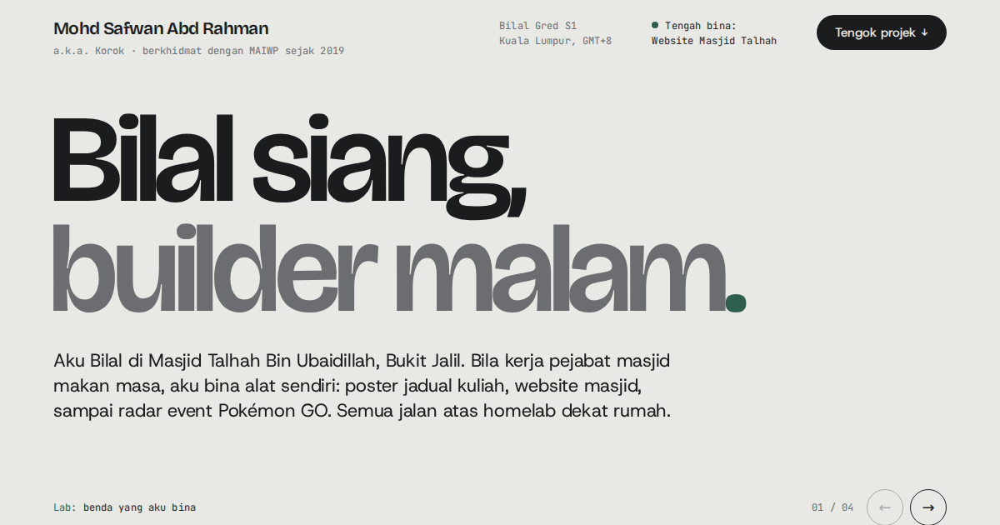

# kengkorok.github.io

Laman portfolio peribadi Mohd Safwan Abd Rahman (Korok): Bilal siang, builder malam.

**Live:** https://kengkorok.github.io/



## Isi kandungan

- **Lab**: slaid projek dengan video pratonton
  - Website Masjid Talhah (akan dilancarkan)
  - [PoGo Wave Radar](https://kengkorok.github.io/pogo-wave-radar/)
  - [Jadual Kuliah Generator](https://github.com/Kengkorok/jadual-kuliah-generator)
  - [Servis Tracker](https://kengkorok.github.io/Auto-Services-Tracker/)
- **Kerjaya**: Masjid Talhah, Masjid Abdul Rahman Bin Auf, DevOps dan Homelab
- **Hubungi**: GitHub, Threads, TikTok dan Ko-fi

## Teknologi

HTML, CSS dan JavaScript biasa. Tiada framework dan tiada proses build. Hos di GitHub Pages.

| Fail | Fungsi |
| --- | --- |
| `index.html` | Kandungan laman |
| `styles.css` | Gaya dan susun atur (desktop, tablet, telefon) |
| `main.js` | Slaid Lab, video lazy-load, kad bertindan dan animasi |
| `assets/lab/` | Video pratonton (`.mp4` + versi `-mobile`) dan poster |
| `assets/career/` | Gambar untuk kad kerjaya |

## Jalankan secara local

```bash
python3 -m http.server 4321
```

Kemudian buka http://localhost:4321.

## Tambah projek baru

1. Rakam video demo, kemudian tukar ke MP4:
   ```bash
   ffmpeg -i demo.webm -an -vf "scale=1280:-2" -c:v libx264 -crf 26 -pix_fmt yuv420p -movflags +faststart assets/lab/nama.mp4
   ffmpeg -i demo.webm -an -vf "scale=640:-2" -c:v libx264 -crf 28 -pix_fmt yuv420p -movflags +faststart assets/lab/nama-mobile.mp4
   ffmpeg -ss 1 -i demo.webm -frames:v 1 -vf "scale=1280:-2" assets/lab/nama-poster.jpg
   ```
2. Salin satu `<li class="lab__slide">` dalam `index.html`, tukar video, teks dan pautan.
3. Kemas kini kaunter `01 / 04` dalam `.lab__count`.

## Kredit

- Font: [Bricolage Grotesque](https://fonts.google.com/specimen/Bricolage+Grotesque), [Host Grotesk](https://fonts.google.com/specimen/Host+Grotesk) dan [JetBrains Mono](https://fonts.google.com/specimen/JetBrains+Mono) (Google Fonts, OFL)
- Ikon sosial: [Simple Icons](https://simpleicons.org/) (CC0)

© 2026 Mohd Safwan Abd Rahman
