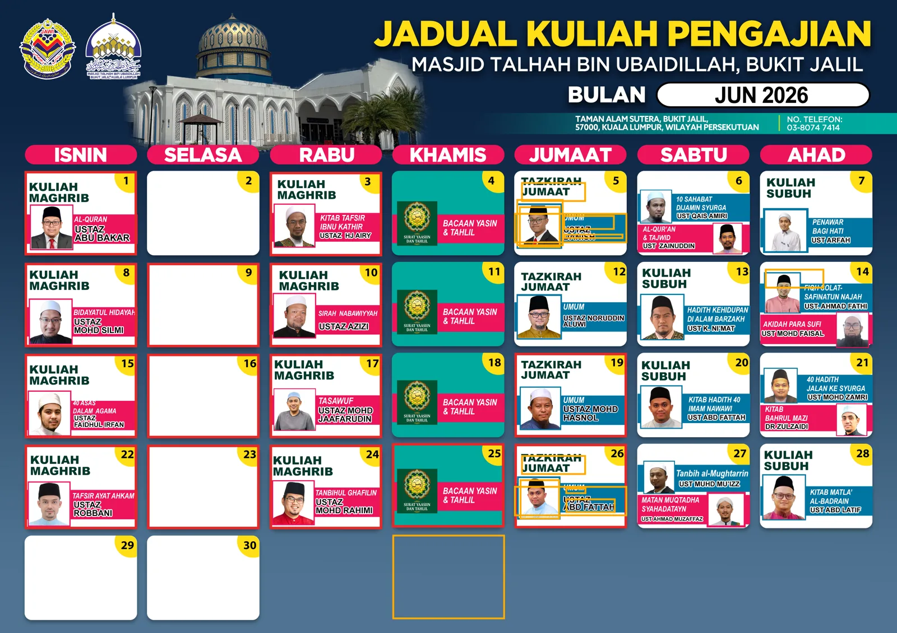
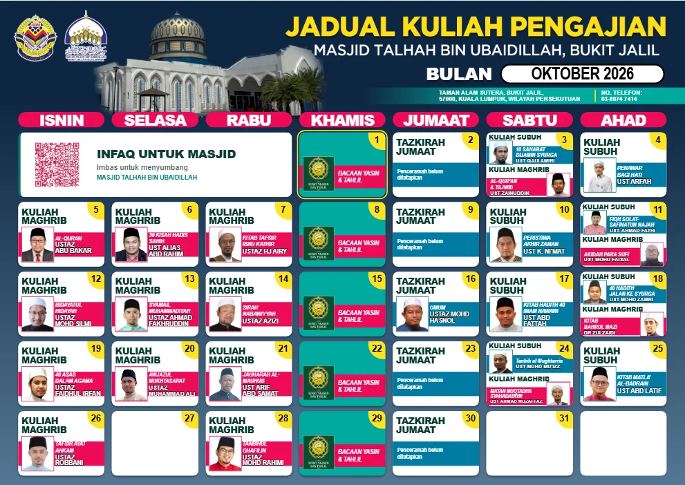

**Ringkasnya:** setiap bulan aku sediakan poster jadual kuliah untuk Masjid Talhah Bin Ubaidillah, Bukit Jalil. Dulu semuanya dibuat secara manual dalam Photoshop, dan satu poster boleh makan masa 30 minit sampai lebih sejam. Fail PSD bulan Jun 2026 ada **256 layer**, 13 daripadanya tersorok, dan hampir separuh kotak tarikh tak sebaris. Sekarang aku guna [Penjana Jadual Kuliah Bulanan](https://github.com/Kengkorok/jadual-kuliah-generator) yang aku bina dengan bantuan AI, dan satu poster siap dalam lebih kurang **10 minit**. Ia percuma, sumber terbuka, dan berjalan terus dalam pelayar.

<!--more-->

Dalam post [Migrasi Poster Jadual Kuliah Masjid dari Photoshop](/blog/migrasi-photoshop-poster-kuliah/) aku dah cerita kenapa aku nak lari dari Photoshop. Post ni sambungannya. Kali ni aku nak tunjuk dengan angka: apa sebenarnya yang berlaku dalam fail PSD tu, dan apa yang berubah.

## Kerja apa yang aku kena buat setiap bulan?

Secara kasar, satu poster ambil masa lebih kurang setengah jam. Itu pon kalau semua maklumat dah lengkap.

Selalunya tak lengkap. Aku kena tunggu bendahari atau ketua imam sahkan dulu penceramah mana yang ada bulan tu. Kadang-kadang penceramah bertukar saat akhir.

Lepas dah dapat pengesahan, ini kerja yang menunggu:

1. **Proses gambar penceramah** dalam _window_ Photoshop lain: buang _background_, potong ikut nisbah 1:1, kemudian letak dalam _frame_.
2. **Ikut warna kotak**, kemudian taip nama penceramah dan tajuk atau kitab yang diajar.
3. **Susun kotak tarikh.** Satu hari bulan kadang-kadang jatuh hari Rabu, kadang-kadang hari Ahad. Setiap bulan aku kena alihkan kotak ikut hari pertama.
4. **Periksa hujung bulan.** Kotak yang berlebihan kena padam, kemudian _adjust_ supaya kotak-kotak putih tu sekata.

Benda ni manual, dan memang merenyahkan. Kadang-kadang lebih sejam. Kalau tak ada _mood_, aku _save_ dulu dan sambung esok.

Masalahnya, poster ni **mesti siap sebelum bulan baru bermula**. Maknanya sekitar 28, 29 atau 30 hari bulan, aku dah mula kelam-kabut.

Sebahagian besar kuliah sekarang dah tetap. Yang selalu berubah ialah **tazkirah Jumaat**, sebab penceramahnya bergilir.

## Apa yang aku jumpa bila bedah fail PSD bulan Jun?

Fail-fail lama ada dalam PC pejabat, jadi fail paling awal yang aku ada di rumah ialah **Jun 2026**. Aku minta Claude bedah fail tu dan kira semuanya. Hasilnya:

- **256 layer** dalam satu poster: 118 layer teks, 66 layer piksel, 34 _shape_, 32 _smart object_ dan 5 _group_.
- **139 layer masih guna nama asal Photoshop**, contohnya "Vector Smart Object copy 27". Nama yang sama tu sahaja dipakai oleh **8 layer** berbeza.
- **13 layer tersorok.** Antaranya nama penceramah tazkirah dan tajuk kuliah dari bulan-bulan sebelum, dan satu kotak tarikh kosong. Ini yang aku maksudkan bila layer "menimbun". Aku tekan ikon mata untuk sorok, dan lama-lama aku sendiri tak tahu layer tu masih dipakai ke tak.
- **14 daripada 30 kotak tarikh lari dari grid.** Tiga lajur kiri (Isnin hingga Rabu) duduk 5 piksel lebih rendah daripada empat lajur kanan. Jarak antara lajur pula berubah-ubah antara 676 dan 680 piksel, dan jarak antara baris antara 504 dan 509 piksel.

Lima piksel tu nampak kecil. Pada poster A3 300 dpi, ia lebih kurang setengah milimeter. Tapi bila dicetak besar dan digantung, mata kita perasan juga ada yang tak kena.

Tak ada siapa yang salah dalam hal ni. Inilah yang jadi bila satu fail disalin dan diubah suai setiap bulan, bertahun-tahun, oleh tangan manusia.

## Kenapa percubaan AI yang awal gagal?

Aku bukan terus berjaya. Mula-mula aku cuba **Hermes** dengan beberapa model, termasuk DeepSeek dan GLM dari Zhipu. Hasilnya tak mirip langsung dengan poster Photoshop yang aku buat sebelum ni.

Aku faham. Mungkin aku sendiri pon belum tahu _tools_ dan _harness_ yang betul untuk kerja macam ni.

Lepas tu aku dengar Claude Code pon boleh buat. Aku cuba. Secara jujurnya, hasilnya pon tak berapa memuaskan bagi aku.

Akhirnya aku kembali buat secara manual dalam Photoshop.

Bila **GPT-6 Astra** dilancarkan pada September 2026, aku cuba sekali lagi. Kali ni prompt aku sangat spesifik: aku nak penjana yang hasilnya **mirip** poster Photoshop aku dari segi grafik, warna dan tulisan. Gambar masjid yang besar di atas pon mesti duduk di belakang, ditindih oleh beberapa layer grafik lain, sama macam dalam PSD.

Tapi tak siap sekali jalan. Prompt pertama dengan Astra pon dah kena _limit_, sebab Astra antara model yang paling mahal masa tu. Aku kena tunggu dan sambung dalam beberapa sesi sebelum hasilnya betul-betul ikut selera aku.

Akhirnya hasilnya hampir sama dengan poster asal. Cuma perlu sedikit _tweak_ untuk kemaskan, dan itu biasa.

## Apa yang penjana ni buat sekarang?

[Penjana Jadual Kuliah Bulanan](https://github.com/Kengkorok/jadual-kuliah-generator) ialah satu fail HTML yang dibuka dalam Edge atau Chrome. Tak perlu akaun, tak perlu pasang apa-apa, dan tak perlu Adobe. Versi semasa ialah 3.0.0.

- **Aturan berulang.** Contohnya "Kuliah Maghrib setiap Isnin ketiga". Tekan _Terapkan pada bulan ini_, dan semua tarikh diisi sendiri.
- **Kalendar disusun automatik** ikut hari pertama bulan. Tiada lagi alih kotak secara manual.
- **Senarai penceramah** disimpan sekali, lengkap dengan nama, kitab dan gambar. Gambar boleh dilaraskan dari segi _crop_, zum dan kedudukan.
- **Ruang QR infaq** diletak sendiri di ruang kosong yang paling luas dalam kalendar.
- **Profil berasingan**, jadi masjid atau surau lain boleh guna untuk jadual mereka sendiri.
- **Eksport PNG 300 dpi atau PDF**, dalam saiz A3 atau A4.

Untuk cetakan, aku eksport A4 dan pilih saiz A3 masa _print_. Hasilnya okey, tak nampak pecah.

## Sebelum dan selepas

| | Photoshop (dulu) | Penjana (sekarang) |
|---|---|---|
| Masa sebulan | 30 minit hingga lebih sejam | Lebih kurang 10 minit |
| Susun kotak tarikh | Manual, ikut hari pertama bulan | Automatik |
| Gambar penceramah | Buang _background_ dan _crop_ setiap kali | Simpan sekali dalam senarai |
| Fail | 1 PSD, 256 layer, 13 tersorok | 1 fail HTML + data simpanan |
| Kotak sebaris? | 14 daripada 30 lari 1 hingga 5 piksel | Sentiasa sebaris, dijana ikut grid 7 lajur |
| Kos perisian | Adobe RM120 sebulan | Percuma |

Untuk bina penjana ni, aku langgan ChatGPT Plus. Kalau tak silap aku, lebih kurang RM99 sebulan. Langganan Adobe pula belum boleh dihentikan sebab kontraknya sampai Disember tahun ni.

## Apa reaksi orang masjid?

Setakat ni poster dari penjana dah dipakai dua kali.

Aku ada tunjuk kepada pegawai, tapi nampaknya mereka tak berapa kisah. Aku faham. Mereka bukan orang grafik, dan tak pernah tengok aliran kerja Photoshop. Yang penting bagi mereka ialah hasil: poster siap dan cantik.

Susah payah di belakang tu mungkin hanya pereka grafik yang faham. Kalau aku cerita kepada pereka grafik lain, aku rasa mereka akan terus faham betapa renyahnya menyusun ratusan layer setiap bulan.

## Apa yang aku belajar?

- **Beri AI contoh yang jelas.** Percubaan yang berjaya ialah bila aku tunjuk poster sebenar dan minta hasil yang mirip, bukan sekadar "buatkan jadual kuliah".
- **Model dan alat memang beri kesan.** Prompt yang sama boleh beri hasil yang sangat berbeza bergantung pada model yang digunakan.
- **Automasi sesuai untuk kerja yang berulang.** Kerja yang sama setiap bulan, dengan peraturan yang tetap, memang patut diserahkan kepada mesin.

## Nak cuba untuk masjid atau surau sendiri?

Setakat ni rasanya belum ada masjid atau surau lain yang guna. Mungkin sebab aku tak pernah promosi pon. Jadi anggaplah post ni promosi pertama. Haha.

Penjana ni percuma dan sumber terbuka di [GitHub](https://github.com/Kengkorok/jadual-kuliah-generator). Muat turun ZIP, buka fail HTML, dan tekan **Cuba contoh** untuk tengok profil demo dengan nama "Penceramah A hingga D". Panduan penuh ada dalam README.

Kalau ada AJK masjid atau surau yang cuba, aku nak sangat dengar macam mana hasilnya.

Jumpa lagi.
